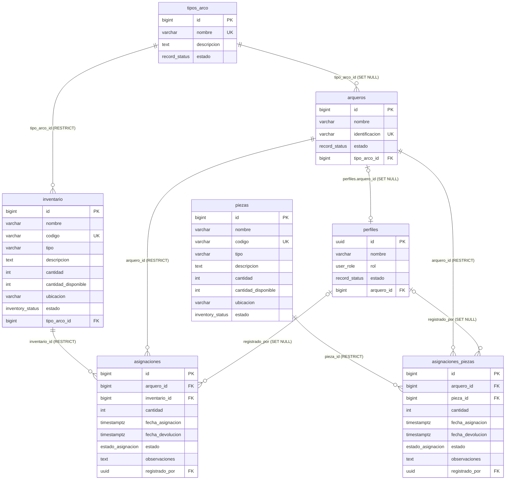
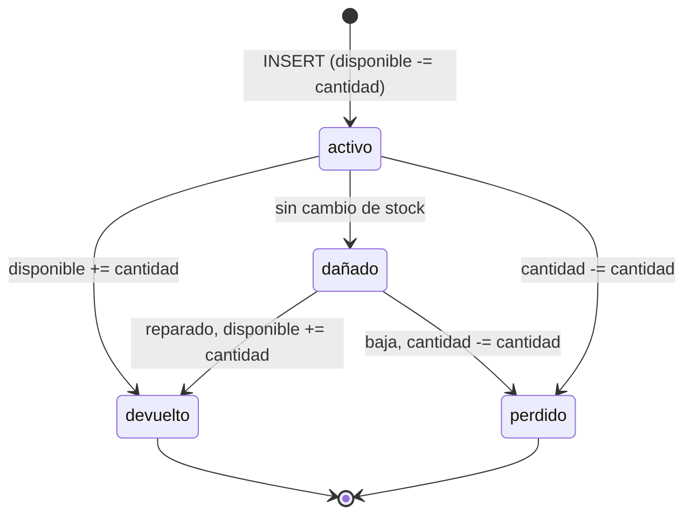
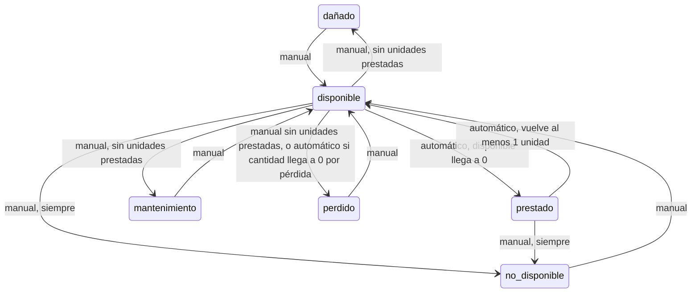

# Documentación técnica — Inventario y trazabilidad

Módulo del objetivo 4 del oficio ADETAO-00027-2026 (Plan de Trabajo 3.4): registrar y administrar arcos, tipos de arco y piezas, y relacionar el inventario con los arqueros para su trazabilidad.

Estado al 10 oct 2026: base de datos, RLS e interfaz terminadas y probadas **solo en local**. Las migraciones no se han aplicado en DEV ni en producción.

Documentos relacionados:
- [`casos-de-prueba.md`](casos-de-prueba.md): casos funcionales de la interfaz con su resultado.
- [`manual-usuario.md`](manual-usuario.md): guía para el personal de ADETAO.
- [`../CHECKLIST_INVENTARIO.md`](../CHECKLIST_INVENTARIO.md): estado de cada ítem con evidencia.

## Contenido

1. [Modelo de datos](#1-modelo-de-datos)
2. [Tablas y restricciones](#2-tablas-y-restricciones)
3. [Triggers y reglas de negocio](#3-triggers-y-reglas-de-negocio)
4. [Estados y transiciones](#4-estados-y-transiciones)
5. [Permisos (RLS) por rol](#5-permisos-rls-por-rol)
6. [Vista `v_historial_asignaciones`](#6-vista-v_historial_asignaciones)
7. [Migraciones](#7-migraciones)
8. [Interfaz: `src/modules/inventario/`](#8-interfaz-srcmodulesinventario)
9. [Verificación en local](#9-verificación-en-local)
10. [Dependencias con Fernando](#10-dependencias-con-fernando)
11. [Límites conocidos](#11-límites-conocidos)
12. [Problemas abiertos de la interfaz](#12-problemas-abiertos-de-la-interfaz)

---

## 1. Modelo de datos

Tablas del módulo: `tipos_arco`, `inventario`, `piezas`, `asignaciones` y `asignaciones_piezas`. `arqueros` y `perfiles` son del módulo de Fernando; aquí solo se leen y se referencian.



Todas las tablas tienen además `created_at` y `updated_at` (`timestamptz`, default `now()`); `updated_at` lo mantiene el trigger `trg_<tabla>_updated_at` (`actualizar_updated_at()`, del baseline).

### Enums

| Enum | Valores | Uso |
|---|---|---|
| `inventory_status` | `disponible`, `prestado`, `mantenimiento`, `dañado`, `no_disponible`, `perdido` | `inventario.estado`, `piezas.estado` |
| `estado_asignacion` | `activo`, `devuelto`, `perdido`, `dañado` | `asignaciones.estado`, `asignaciones_piezas.estado` |
| `record_status` | `activo`, `inactivo` | `tipos_arco.estado` (y `arqueros`, `perfiles`, de Fernando) |

`inventory_status` viene del baseline; `inventario_enums` renombra `No disponible` a `no_disponible` y agrega `perdido`. `estado_asignacion` es nuevo: antes las columnas `estado` de las asignaciones eran `varchar(30)` y se convirtieron con `USING` (acepta `activa`, `devuelta`, `perdida`, `danado`, `dañada`, `danada`).

### Inventario y piezas

`inventario` guarda equipo identificable o que se presta completo (arcos, dianas, carcajes…); `piezas` guarda repuestos y accesorios que se prestan por cantidad (flechas, cuerdas, visores…). Las dos tablas tienen las mismas reglas de stock y comparten funciones de trigger. Las diferencias son:

- `inventario.tipo` es obligatorio; `piezas.tipo` es opcional.
- Solo `inventario` tiene `tipo_arco_id`, obligatorio cuando el tipo es `arco`.

En ambas, lo prestado se calcula como `cantidad - cantidad_disponible` (incluye los préstamos `activo` y `dañado`).

## 2. Tablas y restricciones

### `tipos_arco`

| Columna | Tipo | Nulo | Default |
|---|---|---|---|
| `id` | `bigint` identity | no | |
| `nombre` | `varchar(100)` | no | |
| `descripcion` | `text` | sí | |
| `estado` | `record_status` | no | `activo` |

- `tipos_arco_nombre_unique`: UNIQUE (`nombre`). La interfaz también compara sin distinguir mayúsculas antes de enviar.
- No se borra: se desactiva (`estado = 'inactivo'`); no hay política DELETE.

### `inventario`

| Columna | Tipo | Nulo | Default |
|---|---|---|---|
| `id` | `bigint` identity | no | |
| `nombre` | `varchar(150)` | no | |
| `codigo` | `varchar(50)` | sí | |
| `tipo` | `varchar(100)` | no | |
| `descripcion` | `text` | sí | |
| `cantidad` | `integer` | no | `1` |
| `cantidad_disponible` | `integer` | no | `1` (el trigger la iguala a `cantidad` al crear) |
| `ubicacion` | `varchar(150)` | sí | |
| `estado` | `inventory_status` | no | `disponible` |
| `tipo_arco_id` | `bigint` | sí | |

| Restricción | Regla |
|---|---|
| `inventario_codigo_unique` | UNIQUE (`codigo`); admite varios `NULL` |
| `inventario_cantidad_check` | `cantidad >= 0` |
| `inventario_disponible_check` | `0 <= cantidad_disponible <= cantidad` |
| `inventario_arco_tipo_arco_check` | `lower(btrim(tipo)) <> 'arco' or tipo_arco_id is not null` |
| `inventario_tipo_arco_id_fkey` | FK a `tipos_arco(id)`, `ON DELETE RESTRICT`, `ON UPDATE CASCADE` |
| `idx_inventario_tipo_arco` | índice en `tipo_arco_id` |

### `piezas`

Igual que `inventario`, salvo que `tipo` admite `NULL`, `cantidad` y `cantidad_disponible` tienen default `0` y no hay `tipo_arco_id`. Restricciones: `piezas_codigo_unique`, `piezas_cantidad_check` y `piezas_disponible_check`.

### `asignaciones` y `asignaciones_piezas`

| Columna | Tipo | Nulo | Default |
|---|---|---|---|
| `id` | `bigint` identity | no | |
| `arquero_id` | `bigint` | no | |
| `inventario_id` / `pieza_id` | `bigint` | no | |
| `cantidad` | `integer` | no | `1` |
| `fecha_asignacion` | `timestamptz` | no | `now()` |
| `fecha_devolucion` | `timestamptz` | sí | |
| `estado` | `estado_asignacion` | no | `activo` |
| `observaciones` | `text` | sí | |
| `registrado_por` | `uuid` | sí | `auth.uid()` |

| Restricción (`asignaciones` / `asignaciones_piezas`) | Regla |
|---|---|
| `asignaciones_cantidad_check` / `asignaciones_piezas_cantidad_check` | `cantidad > 0` |
| `asignaciones_fechas_check` / `asignaciones_piezas_fechas_check` | `fecha_devolucion is null or fecha_devolucion >= fecha_asignacion` |
| `asignaciones_devuelto_fecha_check` / `asignaciones_piezas_devuelto_fecha_check` | `estado <> 'devuelto' or fecha_devolucion is not null` |
| `asignaciones_inventario_id_fkey` / `asignaciones_piezas_pieza_id_fkey` | FK al artículo o pieza, `ON DELETE RESTRICT` |
| `asignaciones_arquero_id_fkey` / `asignaciones_piezas_arquero_id_fkey` | FK a `arqueros(id)`, `ON DELETE RESTRICT` (antes `CASCADE`; ver sección 10) |
| `asignaciones_registrado_por_fkey` / `asignaciones_piezas_registrado_por_fkey` | FK a `perfiles(id)`, `ON DELETE SET NULL` (baseline) |
| `idx_asignaciones_registrado_por`, `idx_asignaciones_piezas_registrado_por`, `idx_asignaciones_piezas_arquero`, `idx_asignaciones_piezas_pieza` | índices |

Con `RESTRICT` en las tres FK, el historial no se pierde: no se puede borrar un arquero, un artículo ni una pieza que tenga préstamos.

## 3. Triggers y reglas de negocio

Todos los mensajes de error están en español y llegan a la interfaz con código `P0001`; `errores.js` los muestra tal cual.

| Trigger | Tabla | Momento | Función |
|---|---|---|---|
| `trg_asignaciones_validar_alta` | `asignaciones` | BEFORE INSERT | `asignacion_validar_alta()` |
| `trg_asignaciones_piezas_validar_alta` | `asignaciones_piezas` | BEFORE INSERT | `asignacion_validar_alta()` |
| `trg_asignaciones_validar_cambio` | `asignaciones` | BEFORE UPDATE | `asignacion_validar_cambio()` |
| `trg_asignaciones_piezas_validar_cambio` | `asignaciones_piezas` | BEFORE UPDATE | `asignacion_validar_cambio()` |
| `trg_inventario_control_stock` | `inventario` | BEFORE INSERT OR UPDATE | `articulo_control_stock()` |
| `trg_piezas_control_stock` | `piezas` | BEFORE INSERT OR UPDATE | `articulo_control_stock()` |
| `trg_inventario_validar_tipo_arco` | `inventario` | BEFORE INSERT OR UPDATE OF `tipo_arco_id` | `inventario_validar_tipo_arco()` |

Las funciones de asignación sirven para las dos tablas y distinguen con `tg_table_name`.

### `asignacion_validar_alta()` — registrar un préstamo

`SECURITY DEFINER`, `search_path = public`. Versión vigente: `20261010120000_inventario_reglas_prestamo.sql`. En orden:

1. El estado debe ser `activo`: `Una asignación nueva debe registrarse con estado "activo".`
2. Sin `fecha_devolucion`: `Una asignación nueva no puede tener fecha de devolución.`
3. `registrado_por := auth.uid()` (si hay sesión), aunque el cliente envíe otro valor.
4. El arquero debe existir y estar activo (lee `arqueros.nombre, estado`): `El arquero indicado no existe.` / `No se puede prestar a "%": el arquero está inactivo.`
5. Bloquea la fila del artículo o pieza con `SELECT … FOR UPDATE`, para que dos préstamos simultáneos no usen las mismas unidades. Si no existe: `El artículo indicado no existe.`
6. El artículo no puede estar en `mantenimiento`, `dañado`, `no_disponible` ni `perdido`: `No se puede asignar "%": el artículo está en estado "%".` Un artículo `prestado` no tiene unidades, así que lo rechaza el paso 7.
7. Stock: `Stock insuficiente para "%": se solicitaron % y hay % disponibles.`
8. Descuenta `cantidad_disponible` del artículo o pieza.

### `asignacion_validar_cambio()` — devolver, dañado, perdido

`SECURITY DEFINER`, `search_path = public`. Versión: `20261009150300_inventario_stock.sql`.

1. Campos que no se pueden cambiar:
   - `cantidad`: `No se puede modificar la cantidad de una asignación. Registre la devolución y cree una nueva asignación.`
   - `arquero_id`: `No se puede cambiar el arquero de una asignación.`
   - `inventario_id` / `pieza_id`: `No se puede cambiar el artículo (la pieza) de una asignación.`
   - `registrado_por`: `No se puede cambiar quién registró una asignación.`
2. Si el estado no cambia (por ejemplo, solo se editan las observaciones), no hace nada más.
3. Aplica la transición (sección 4) y ajusta el artículo:
   - a `devuelto`: `cantidad_disponible += cantidad`;
   - a `perdido`: `cantidad -= cantidad`;
   - de `activo` a `dañado`: nada (las unidades siguen fuera).
   - Cualquier otra: `Transición de estado no permitida: de "%" a "%".`
4. Si pasa a `devuelto` sin fecha, pone `fecha_devolucion = now()`.

### `articulo_control_stock()` — cantidades y estado del artículo

Sin `SECURITY DEFINER`. Versión vigente: `20261010123000_inventario_perdido_total.sql`. Usa `pg_trigger_depth()` para separar los cambios directos (profundidad 1, desde la interfaz o SQL) de los que vienen del trigger de una asignación (profundidad > 1).

Al **insertar**:
- Rechaza `estado = 'prestado'`: `El estado "prestado" se asigna automáticamente cuando no quedan unidades disponibles; no se puede elegir a mano.`
- `cantidad_disponible := cantidad`.

En un **cambio directo** (profundidad 1):
- `cantidad_disponible` no se puede tocar: `La cantidad disponible no se puede modificar directamente; se calcula a partir de las asignaciones.` (también para `postgres`).
- No se puede elegir `prestado` (mismo mensaje que al insertar).
- Con unidades prestadas (`cantidad - cantidad_disponible > 0`), no se puede pasar a `mantenimiento`, `dañado` ni `perdido`: `No se puede cambiar "%" a "%": hay % unidades prestadas. Primero registre la devolución.` `no_disponible` sí se permite (decisión del 10 oct 2026).
- Si cambia `cantidad`: no puede quedar por debajo de lo prestado (`No se puede reducir la cantidad de "%" a %: hay % unidades asignadas.`) y `cantidad_disponible` se mueve la misma diferencia.

En un **cambio desde una asignación** (profundidad > 1):
- Si `cantidad` pasa de más de 0 a 0 (se perdieron todas las unidades), el artículo queda `perdido`.
- Bajar la cantidad a 0 a mano no es una pérdida y no cambia el estado.

En **todos los casos**, si el estado es `disponible` o `prestado`, se recalcula: `prestado` cuando `cantidad > 0` y `cantidad_disponible = 0`, si no `disponible`.

### `inventario_validar_tipo_arco()` — tipo de arco activo

Solo actúa al insertar o al cambiar `tipo_arco_id`: `El tipo de arco "%" está inactivo. Elija un tipo de arco activo.` Un artículo cuyo tipo se desactivó después se puede seguir editando mientras no cambie de tipo.

### Reglas y pruebas pgTAP

Las 109 pruebas están en `supabase/tests/database/inventario.test.sql`. La tabla completa regla → prueba pgTAP → caso de UI está en el anexo de [`casos-de-prueba.md`](casos-de-prueba.md#anexo-reglas-de-bd-y-sus-pruebas-pgtap). Resumen:

| Regla | Dónde vive | Pruebas pgTAP (ejemplos) |
|---|---|---|
| Disponible = total al crear | `articulo_control_stock()` | "Al crear un artículo, cantidad_disponible = cantidad" |
| Disponible no se edita a mano | `articulo_control_stock()` | "UPDATE directo de cantidad_disponible en inventario se rechaza" |
| Cantidad no baja de lo prestado | `articulo_control_stock()` | "Bajar cantidad por debajo de lo asignado se rechaza" |
| Arco exige tipo de arco activo | `inventario_arco_tipo_arco_check`, `inventario_validar_tipo_arco()` | "Un arco sin tipo_arco_id se rechaza", "Crear un arco con un tipo de arco inactivo se rechaza" |
| Stock al prestar | `asignacion_validar_alta()` | "Asignar sin stock suficiente se rechaza" |
| Solo arqueros activos | `asignacion_validar_alta()` | "Prestar inventario a un arquero inactivo se rechaza", "Se puede devolver aunque el arquero ya esté inactivo" |
| Artículo en estado prestable | `asignacion_validar_alta()` | "Asignar un artículo en mantenimiento se rechaza" |
| `registrado_por` automático | default, `asignacion_validar_alta()`, `asignacion_validar_cambio()` | "registrado_por se fuerza a auth.uid() aunque se envíe otro valor" |
| Campos fijos del préstamo | `asignacion_validar_cambio()` | "Modificar la cantidad de una asignación se rechaza" |
| Transiciones | `asignacion_validar_cambio()` | "Transición activo -> dañado", "Transición devuelto -> activo se rechaza" |
| Fecha de devolución | `*_fechas_check`, `*_devuelto_fecha_check`, `asignacion_validar_cambio()` | "Al devolver sin fecha se registra fecha_devolucion" |
| `prestado` y `perdido` automáticos | `articulo_control_stock()` | "Sin unidades disponibles el artículo pasa a prestado", "Si se pierden todas las unidades, el artículo queda perdido (0/0)" |
| Estado con unidades prestadas | `articulo_control_stock()` | "Pasar a mantenimiento con unidades prestadas se rechaza" |
| El historial se conserva | FK `RESTRICT`, sin DELETE en RLS | "Admin no puede borrar asignaciones", "No se puede borrar un arquero con asignaciones (ON DELETE RESTRICT)" |

## 4. Estados y transiciones

### Préstamo (`estado_asignacion`)



`devuelto` y `perdido` son finales. Cualquier flecha que no esté en el diagrama (por ejemplo, `dañado → activo` o `devuelto → activo`) se rechaza. En la interfaz, `OPCIONES_DEVOLUCION` (`constantes.js`) ofrece solo estas transiciones:

| Desde | Opción en la interfaz | Pasa a | Observaciones |
|---|---|---|---|
| `activo` | Devolver en buen estado | `devuelto` | opcional |
| `activo` | Devolver dañado | `dañado` | obligatoria |
| `activo` | Reportar como perdido | `perdido` | obligatoria |
| `dañado` | Reparado: vuelve al inventario | `devuelto` | opcional |
| `dañado` | Dar de baja como perdido | `perdido` | obligatoria |

Al cerrar un préstamo `dañado` se conserva la `fecha_devolucion` de cuando el arquero lo entregó; la fecha de la reparación o la baja queda en la nota (`[dd/mm/aaaa Reparado] …`).

### Artículo o pieza (`inventory_status`)



- `prestado` nunca se elige a mano. Si se elige `disponible` sin unidades en bodega, la BD lo deja en `prestado` y la interfaz lo avisa.
- Desde `mantenimiento`, `dañado`, `no_disponible` y `perdido` se puede pasar a cualquier otro estado manual (el diagrama muestra solo la vuelta a `disponible`), salvo las restricciones por unidades prestadas.
- Un artículo en `mantenimiento`, `dañado`, `no_disponible` o `perdido` no se presta.

## 5. Permisos (RLS) por rol

Funciones de rol (compartidas, `20261009150000_base_roles.sql`, **pendientes de acordar con Fernando**), todas `SECURITY DEFINER` y solo para `authenticated` y `service_role`:

| Función | Devuelve |
|---|---|
| `rol_actual()` | `perfiles.rol` del usuario actual si su perfil está `activo`; si no, `NULL` |
| `es_admin()` | `rol_actual() = 'administrador'` |
| `es_staff()` | `rol_actual()` es `administrador` o `profesor` |
| `mi_arquero_id()` | `perfiles.arquero_id` del usuario actual si su perfil está `activo` |

Un perfil `inactivo` se trata como un usuario sin rol. Las políticas usan `(select public.es_staff())` para que Postgres evalúe la función una vez por consulta.

### Matriz

✓ = permitido; ✗ = sin política (la operación no afecta filas o da error `42501`).

| Tabla | Operación | Administrador | Profesor | Usuario con arquero | Usuario sin arquero | Anónimo |
|---|---|---|---|---|---|---|
| `tipos_arco` | SELECT | ✓ | ✓ | ✓ | ✓ | ✗ |
| | INSERT / UPDATE | ✓ | ✗ | ✗ | ✗ | ✗ |
| | DELETE | ✗ (se desactiva) | ✗ | ✗ | ✗ | ✗ |
| `inventario`, `piezas` | SELECT | ✓ | ✓ | solo lo que tiene o tuvo prestado | ✗ (0 filas) | ✗ |
| | INSERT / UPDATE | ✓ | ✓ | ✗ | ✗ | ✗ |
| | DELETE | ✓ (si no tiene préstamos, por la FK) | ✗ | ✗ | ✗ | ✗ |
| `asignaciones`, `asignaciones_piezas` | SELECT | ✓ | ✓ | solo las suyas | ✗ (0 filas) | ✗ |
| | INSERT / UPDATE | ✓ | ✓ | ✗ | ✗ | ✗ |
| | DELETE | ✗ | ✗ | ✗ | ✗ | ✗ |
| `v_historial_asignaciones` | SELECT | ✓ | ✓ | solo lo suyo | ✗ (0 filas) | ✗ (sin GRANT) |

Políticas (18, en `20261009150500_inventario_rls.sql`; `inventario_reglas_prestamo` elimina `tipos_arco: admin elimina`, así que quedan 17):

| Tabla | Políticas |
|---|---|
| `tipos_arco` | `tipos_arco: autenticados consultan` (`true`), `tipos_arco: admin inserta`, `tipos_arco: admin actualiza` |
| `inventario` | `inventario: staff o asignado consulta` (`es_staff()` o existe una asignación propia de ese artículo), `inventario: staff inserta`, `inventario: staff actualiza`, `inventario: admin elimina` |
| `piezas` | las mismas cuatro, sobre `asignaciones_piezas` |
| `asignaciones` | `asignaciones: staff o propias consulta` (`es_staff()` o `arquero_id = mi_arquero_id()`), `asignaciones: staff inserta`, `asignaciones: staff actualiza` |
| `asignaciones_piezas` | las mismas tres |

Además, `inventario_reglas_prestamo` hace `REVOKE ALL` a `anon` sobre las cinco tablas.

### Permisos en la interfaz

La interfaz oculta lo que el rol no puede hacer; el RLS es la protección real:

- El menú "Inventario" (`Sidebar.jsx`, compartido) solo aparece para administrador y profesor.
- La pestaña "Préstamos" y el botón "Historial" de cada fila solo se muestran con `esStaff`.
- En "Tipos de arco", los botones de crear, editar, desactivar y reactivar solo se muestran con `esAdmin`; el profesor ve el aviso "Catálogo de solo lectura".
- La vista del rol usuario ("Mis préstamos") no existe todavía: necesita una entrada en `Sidebar.jsx` (sección 10).

## 6. Vista `v_historial_asignaciones`

Definida en `20261009150400_inventario_historial.sql`. Une los préstamos de artículos y de piezas en una sola lista para los historiales.

- `security_invoker = true`: la vista aplica el RLS de quien consulta, no el del dueño. Cada rol ve en la vista lo mismo que vería en las tablas.
- Permisos: `REVOKE ALL` a `anon` y `authenticated`, luego `GRANT SELECT` a `authenticated` y `service_role`. Solo lectura.
- Es `UNION ALL` de `asignaciones` (con `LEFT JOIN` a `inventario`) y `asignaciones_piezas` (con `LEFT JOIN` a `piezas`), las dos con `LEFT JOIN` a `arqueros` y `perfiles`.

| Columna | Origen |
|---|---|
| `tipo_registro` | `'inventario'` o `'pieza'` |
| `asignacion_id` | `id` de la asignación |
| `articulo_id`, `articulo_codigo`, `articulo_nombre`, `articulo_tipo` | `inventario` o `piezas` |
| `arquero_id`, `arquero_nombre`, `arquero_identificacion` | `arqueros` |
| `cantidad`, `fecha_asignacion`, `fecha_devolucion`, `estado`, `observaciones` | asignación |
| `registrado_por` | asignación (`uuid`) |
| `registrado_por_nombre` | `perfiles.nombre`; sale `NULL` si quien consulta no puede leer ese perfil (sección 11) |
| `created_at`, `updated_at` | asignación |

`asignacion_id` se repite entre las dos tablas; la clave de una fila es (`tipo_registro`, `asignacion_id`). Para registrar una devolución, la interfaz usa `tipo_registro` para saber qué tabla actualizar.

`listarHistorial({ arqueroId, tipoRegistro, articuloId })` en `inventarioService.js` consulta la vista ordenada por `fecha_asignacion` y `asignacion_id` descendentes.

## 7. Migraciones

En `supabase/migrations/`, en orden de aplicación:

| Migración | Contenido |
|---|---|
| `20261009141945_remote_schema.sql` | Baseline traído con `db pull` desde producción: tablas, enums, triggers `updated_at` y políticas `true` originales. |
| `20261009150000_base_roles.sql` | Compartida, **pendiente de acordar con Fernando**: `perfiles.arquero_id` y funciones de rol. |
| `20261009150100_inventario_enums.sql` | `no_disponible`, `perdido` y el enum `estado_asignacion`. Va sola porque un valor agregado con `ADD VALUE` no se puede usar en la misma transacción. |
| `20261009150200_inventario_estructura.sql` | `inventario.tipo_arco_id` y su CHECK, `piezas.codigo/ubicacion`, conversión de `estado` a enum, CHECK de fechas, FK a arqueros con `RESTRICT`, índices y `DEFAULT auth.uid()`. |
| `20261009150300_inventario_stock.sql` | Triggers de asignación y primera versión de `articulo_control_stock()`. |
| `20261009150400_inventario_historial.sql` | Vista `v_historial_asignaciones`. |
| `20261009150500_inventario_rls.sql` | Reemplaza las 10 políticas `true` por las políticas por rol. |
| `20261010120000_inventario_reglas_prestamo.sql` | Arquero activo, tipo de arco activo, estados con unidades prestadas, `prestado` automático (normaliza antes los datos existentes), sin DELETE en `tipos_arco`, `REVOKE ALL` a `anon`. |
| `20261010123000_inventario_perdido_total.sql` | `articulo_control_stock()` final: `perdido` automático al perderse todas las unidades. |

`supabase/seed.sql` (solo local) crea los usuarios `admin@adetao.test`, `profesor@adetao.test` y `usuario@adetao.test` (vinculado a la arquera María Rodríguez Solís), 4 arqueros, 4 tipos de arco, 8 artículos, 6 piezas, 4 préstamos de artículos y 3 de piezas.

Antes de aplicar en DEV o producción, revisar con consultas de solo lectura: arcos sin `tipo_arco_id`, valores de `estado` de asignaciones que no se puedan mapear, que `cantidad_disponible` cuadre con los préstamos activos y qué filas cambiará la normalización de `prestado` (checklist, sección 1, Validación).

## 8. Interfaz: `src/modules/inventario/`

React + Vite, sin router. `Dashboard.jsx` (compartido) monta `<Inventario profile={profile} />` cuando `activeMenu === 'inventario'`.

```
src/modules/inventario/
├── Inventario.jsx          contenedor con pestañas: Artículos, Piezas, Préstamos (solo staff), Tipos de arco
├── Inventario.css          estilos del módulo (prefijo .inv-); tabla en tarjetas en pantallas angostas
├── TiposArco.jsx           catálogo de tipos de arco; escritura solo para admin; aviso de uso al desactivar
├── ArticulosTabla.jsx      listado de artículos o piezas (prop tabla), búsqueda, filtros, cambio rápido de estado
├── ArticuloForm.jsx        crear/editar artículo o pieza; valida obligatorios, cantidad y tipo de arco
├── Prestamos.jsx           vistas "Préstamos activos" e "Historial por arquero"; filtros y búsqueda
├── PrestamoForm.jsx        nuevo préstamo de artículo o pieza; valida cantidad contra lo disponible
├── DevolucionForm.jsx      devolver o cerrar un préstamo; valida fecha y observaciones; botón Actualizar si la lista está desactualizada
├── HistorialTabla.jsx      tabla reutilizable de movimientos del historial
├── HistorialArquero.jsx    "Tiene ahora" y "Préstamos anteriores" de un arquero
├── HistorialArticulo.jsx   historial de un artículo o pieza (modal)
├── SelectorArquero.jsx     buscador de arqueros por nombre o identificación
├── Modal.jsx               ventana modal genérica (.inv-modal)
├── inventarioService.js    todas las consultas a Supabase
├── errores.js              traducción de errores de Postgres/PostgREST a español
└── constantes.js           estados, etiquetas, opciones de devolución, textos, formatearFecha, fechaDevolucionFinal
```

### `inventarioService.js`

| Función | Qué hace |
|---|---|
| `listarTiposArco()`, `guardarTipoArco()`, `cambiarEstadoTipoArco()` | catálogo de tipos de arco |
| `contarUsoTipoArco(id)` | cuenta arqueros (lectura de `arqueros`) y artículos que usan un tipo |
| `listarArticulos(tabla)`, `guardarArticulo(tabla, datos)`, `cambiarEstadoArticulo()` | artículos y piezas; normaliza `tipo` (minúsculas, sin espacios), guarda `''` como `NULL` y nunca envía `cantidad_disponible` |
| `listarArqueros({ soloActivos })` | lectura de `arqueros` (`id, nombre, identificacion, estado`) |
| `listarHistorial(filtros)` | consulta `v_historial_asignaciones` |
| `crearPrestamo()` | INSERT en `asignaciones` o `asignaciones_piezas`; no envía `estado`, `fecha_asignacion` ni `registrado_por` |
| `registrarDevolucion()` | UPDATE con `.eq('estado', estadoMostrado)`: si otra persona ya cerró el préstamo, no lo pisa y lanza `Este préstamo ya se registró como "…". Actualice la lista.` con la marca `listaDesactualizada`, que `DevolucionForm.jsx` usa para mostrar el botón "Actualizar" (cierra el modal y recarga la lista en `Prestamos.jsx`) |
| `agregarObservacion()` | agrega `[dd/mm/aaaa Registro] texto` a las observaciones previas |

Si un INSERT o UPDATE no devuelve filas (el RLS lo filtró), el servicio muestra `No tiene permisos para realizar esta acción.`

### Fecha de devolución (`fechaDevolucionFinal()` en `constantes.js`)

`fecha_asignacion` llega de la BD con microsegundos (`…27.438466+00`) y `Date` la trunca a milisegundos (`.438`). El formulario de devolución propone el minuto actual sin segundos; si el préstamo es de ese mismo minuto, la fecha elegida queda antes de `fecha_asignacion` y `asignaciones_fechas_check` la rechazaría. `fechaDevolucionFinal(fechaElegida, fechaAsignacion)` devuelve la mayor entre la fecha elegida y el segundo siguiente a `fecha_asignacion`. Se usa el segundo siguiente y no `Math.ceil`, porque con `.000` milisegundos y microsegundos distintos de cero `ceil` no cambiaría el valor. Está en `constantes.js` y no en `DevolucionForm.jsx` para poder probarla sin exportar funciones desde un componente (`react/only-export-components`).

### `errores.js` (`traducirError`)

| Código | Mensaje |
|---|---|
| `23505` (UNIQUE) | según la restricción: "Ya existe un tipo de arco con ese nombre.", "Ya existe un artículo con ese código.", "Ya existe una pieza con ese código."; si no, "Ya existe un registro con esos datos." |
| `23514` (CHECK) | según la restricción: "Los arcos deben tener un tipo de arco.", "La cantidad no puede ser negativa.", "La cantidad prestada debe ser mayor que 0.", "La fecha de devolución no puede ser anterior a la fecha del préstamo.", "Una devolución debe tener fecha."; si no, "Los datos no cumplen las reglas del sistema." |
| `23503` (FK) | "El registro está relacionado con otros datos y no se puede modificar así." |
| `42501` (RLS / privilegios) | "No tiene permisos para realizar esta acción." |
| `P0001` (triggers) | el mensaje del trigger, tal cual |
| `Failed to fetch` | "No se pudo conectar con el servidor. Revise su conexión." |
| otro | "Ocurrió un error inesperado. Intente de nuevo." |

## 9. Verificación en local

Requisitos: Docker Desktop en marcha, Node y las dependencias instaladas (`npm install`). Todo se ejecuta desde `adetao-web/` y solo contra la BD local.

> No usar `npx supabase db push`, `supabase link` ni la opción `--linked`: apuntan al proyecto remoto. Cualquier acción contra DEV o producción requiere confirmación explícita.

```powershell
cd adetao-web

# 1. Levantar Supabase local y aplicar las 9 migraciones + seed
npx supabase start
npx supabase db reset --local

# 2. Pruebas pgTAP (109)
npx supabase test db --local        # equivalente: npm run test:db

# 3. Linter y build
npm run lint                        # oxlint
npm run build                       # vite build

# 4. Aplicación contra la BD local
npm run dev                         # http://localhost:5173
```

Para que `npm run dev` use la BD local, `.env.development.local` debe tener `VITE_SUPABASE_URL=http://127.0.0.1:54321` y la `anon key` local (`npx supabase status`). El `.env` del repositorio apunta al proyecto remoto.

Si solo hace falta correr pgTAP, basta con el contenedor de Postgres: `npx supabase start -x` seguido de los servicios que no se necesitan (Studio, Storage, etc.).

Resultado del 10 oct 2026 (rama `inventario`, commit `bad46eb`):

| Verificación | Resultado |
|---|---|
| `npx supabase db reset --local` | 9 migraciones y seed aplicados |
| `npx supabase test db --local` | `Files=1, Tests=109, Result: PASS` |
| `npm run lint` | 0 errores; 2 warnings en `src/modules/dashboard/Dashboard.jsx:17` (compartido) |
| `npm run build` | correcto |
| Casos funcionales en el navegador | 58 casos: 53 pasan, 2 pasan con observaciones, 1 falla, 1 bloqueado, 1 no aplica |

Después de corregir DEV-13, OBS-02 y OBS-04 (10 oct 2026, cambios sin commit sobre `e60c897`, solo en `src/modules/inventario/`):

| Verificación | Resultado |
|---|---|
| `npx supabase test db --local` | `Files=1, Tests=109, Result: PASS` |
| `npm run lint` | 0 errores; los mismos 2 warnings de `Dashboard.jsx:17` |
| `npm run build` | correcto |
| Prueba de humo temporal de DEV-13 (Vite SSR, BD local) | 16 ok, 0 fallos |
| Casos repetidos en el navegador: DEV-13, DEV-10, UI-01 | Pasan. Total: 55 pasan, 1 pasa con observaciones (HIS-07), 0 fallan, 1 bloqueado, 1 no aplica ([detalle](casos-de-prueba.md#resumen)) |

## 10. Dependencias con Fernando

Nada de esta lista se cambia sin acordarlo (`.cursor/rules/alcance-inventario.mdc`).

**Ya hechos, pendientes de acordar:**

| Cambio | Efecto en el módulo de Fernando |
|---|---|
| `20261009150000_base_roles.sql`: `perfiles.arquero_id` (UNIQUE, FK a `arqueros`, `ON DELETE SET NULL`) y `rol_actual()`, `es_admin()`, `es_staff()`, `mi_arquero_id()` | Las políticas de inventario dependen de estas funciones. Falta definir quién asigna `perfiles.arquero_id` (hoy no hay política UPDATE en `perfiles`; solo el seed lo llena). |
| FK de asignaciones a `arqueros` con `ON DELETE RESTRICT` (antes `CASCADE`) | Un arquero con préstamos ya no se puede borrar; habría que desactivarlo. |
| `asignacion_validar_alta()` lee `arqueros.estado` | Si cambia el significado de `estado`, cambia la regla de préstamo. |
| `listarArqueros()` y `contarUsoTipoArco()` leen `arqueros` | Funciona porque el RLS de `arqueros` es `true` para autenticados. Si cambia, el staff debe poder seguir leyendo `id, nombre, identificacion, estado, tipo_arco_id`. |
| `Dashboard.jsx`: import de `Inventario` y la rama `activeMenu === 'inventario'` en `renderContenido()` | Es la única forma de mostrar el módulo mientras no haya router. |
| `supabase/seed.sql`: 4 arqueros y `perfiles.rol` / `perfiles.arquero_id` de los usuarios de prueba | Solo local. |

**Necesarios a futuro:**

- RLS de `perfiles`: que el staff pueda leer el `nombre` de otros perfiles, para `registrado_por_nombre` (sección 11).
- `Sidebar.jsx`: entrada para que el rol usuario vea sus préstamos ("Mis préstamos").
- `Dashboard.jsx`: tarjeta "Inventario" con dato real (hoy `0` fijo), `onClick` de "+ Agregar inventario" y no recargar el panel en cada evento de sesión (OBS-01 en sección 12).
- Indicadores de inventario para el dashboard (objetivo 5): se proponen, pero se acuerdan con Fernando.

## 11. Límites conocidos

1. **Devolución parcial no soportada.** Una devolución cierra el préstamo completo: `asignacion_validar_cambio()` no permite cambiar `cantidad` y no existe un estado intermedio. Si un arquero devuelve 4 de 6 flechas, el procedimiento provisional (en [`manual-usuario.md`](manual-usuario.md#84-cuando-el-arquero-devuelve-solo-una-parte-procedimiento-provisional)) es registrar la devolución completa y crear un préstamo nuevo por las unidades pendientes, con la observación "Pendiente de devolución parcial del préstamo del [fecha]". Ese préstamo nuevo falla si el arquero ya está inactivo. Si ADETAO necesita devoluciones parciales, hay que cambiar el modelo; por ejemplo, que la devolución parcial divida la asignación en una devuelta y otra activa dentro de un trigger o una función.
2. **Fecha límite de devolución por definir con ADETAO.** Los préstamos no tienen fecha prevista de devolución, así que no se puede saber cuáles están vencidos. Si ADETAO la necesita: agregar `fecha_devolucion_prevista` (con CHECK `>= fecha_asignacion`) a las dos tablas de asignaciones y a la vista, pedirla en `PrestamoForm.jsx` y marcar como vencidos los préstamos `activo` cuya fecha ya pasó.
3. **"Registrado por" limitado por el RLS de `perfiles`.** `perfiles` solo tiene la política "Usuarios pueden consultar su propio perfil" (`id = auth.uid()`). Por eso `registrado_por_nombre` en `v_historial_asignaciones` (que es `security_invoker`) sale `NULL` cuando el préstamo lo registró otra persona; la interfaz muestra "—" con la nota "Nombre no disponible". El `uuid` en `registrado_por` siempre se guarda bien. Se resuelve con una política de lectura en `perfiles` para el staff, que es de Fernando.

## 12. Problemas abiertos de la interfaz

Encontrados en la ejecución de los casos de prueba del 10 oct 2026. DEV-13, OBS-02 y OBS-04 se corrigieron el mismo día (tabla de abajo); OBS-01 y OBS-03 dependen de código compartido.

| ID | Problema | Dónde | Corrección |
|---|---|---|---|
| DEV-13 | Devolver en el mismo minuto del préstamo daba "La fecha de devolución no puede ser anterior a la fecha del préstamo." (microsegundos de `fecha_asignacion` truncados a milisegundos). | `DevolucionForm.jsx`, `constantes.js` | `fechaDevolucionFinal()` (sección 8). DEV-13 pasa. |
| OBS-02 | El aviso "Actualice la lista" no tenía un botón para hacerlo. | `inventarioService.js`, `DevolucionForm.jsx`, `Prestamos.jsx` | Botón "Actualizar" en el aviso; cierra el modal y recarga la lista. DEV-10 pasa. |
| OBS-04 | En 390 px, la pestaña "Tipos de arco" quedaba fuera de la pantalla sin indicación y el filtro de tipo de arco sobresalía unos 40 px. El selector "Préstamos activos / Historial por arquero" cortaba unos 21 px sin sombra. | `Inventario.css` | Sombras de desplazamiento en `.inv-pestanas` y en `.inv-vistas` (`background-attachment: local`/`scroll`; tapas `#f5f5f5` en las pestañas y `#f7f7f7` en el selector) y `min-width: 0` en los filtros a 750 px o menos. UI-01 pasa. |

Siguen abiertos:

| ID | Problema | Dónde | Propuesta |
|---|---|---|---|
| OBS-01 | El panel completo se recarga cada vez que la pestaña del navegador vuelve a quedar visible: se pierde la pestaña activa y cualquier formulario abierto. Cada `visibilitychange` hace que supabase-js emita un evento de sesión con un objeto nuevo; `App.jsx` llama a `setSession` y `Dashboard.jsx` vuelve a cargar el perfil (`useEffect(…, [session])`). | `App.jsx`, `Dashboard.jsx` (compartidos) | **Pendiente de acordar con Fernando:** depender de `session.user.id` en lugar del objeto `session`, o no mostrar "Cargando sistema…" al refrescar. |
| OBS-03 | El inicio del rol usuario muestra la tarjeta "Inventario" con `0` fijo y "+ Agregar inventario" sin acción. | `Dashboard.jsx` (compartido) | **Pendiente de acordar con Fernando** (sección 10). |
